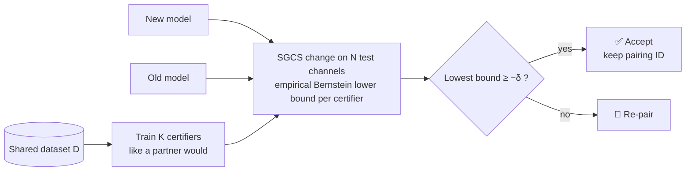

<div align="center">

# Partner-Free Compatibility Certification

### Safe model updates for two-sided AI CSI feedback in multi-vendor 6G networks

[](https://www.mathworks.com/products/matlab.html)
[](https://www.mathworks.com/products/5g.html)
[](https://www.mathworks.com/products/deep-learning.html)
[](#-verify-the-rule)
[](#-background)


**Can a vendor update its half of a two-sided AI model without seeing the other half?**
This repository gives a statistical test that answers yes or no, with a proven error bound.

[Background](#-background) ·
[How it works](#-how-it-works) ·
[Results](#-results) ·
[Quick start](#-quick-start) ·
[Code map](#-code-map) ·
[Citation](#-citation)

</div>

---

## 📡 Background

In 5G-Advanced and 6G, AI-based CSI feedback splits one neural network across two devices.
The **UE** runs an encoder that compresses the channel into a short message.
The **base station** runs a decoder that expands it again.
The two halves usually come from **different vendors**. They agree on the meaning of the message only because they were trained on the same shared dataset, which 3GPP Release 20 tracks with a **pairing ID**.

After deployment, every vendor keeps updating its own model. It retrains on new data, adapts to new sites, or quantizes the model for new hardware. Each update can silently break partners that the vendor **cannot see**.
3GPP now gives an updated dataset a new pairing ID, so the ID records **where a model came from**. It does not say **whether partners still work**.

> **Goal:** let the updating vendor decide alone, before release, whether an update keeps every hidden partner within a tolerance δ, with a known risk of being wrong.

---

## ⚙️ How it works



1. **Build certifiers.** Train *K* models on the shared dataset *D*, drawn from a pool of plausible partner designs: MLP, CNN and self-attention models, SGCS or NMSE loss, float or quantized latents, and all or half of *D*.
2. **Measure the change.** On *N* held-out channels, compute each certifier's SGCS change between the old and new model, and an empirical Bernstein lower confidence bound at level α/*K*.
3. **Decide.** Accept if the *j*-th smallest bound is at least −δ. Otherwise re-pair.

**Theorem 1.** If a hidden partner and the certifiers are exchangeable implementations trained from *D*, and the update was not trained on the certifiers or the test channels, then

$$
\Pr\big(\text{accept} \;\wedge\; \text{partner loses more than } \delta\big) \;\le\; \frac{j}{K+1} + \alpha .
$$

For *M* partners at once (*j* = 1) the bound is *M*/(*K*+*M*) + α. The test needs **no access to partner models** and **no standardized reference model**.

---

## 📊 Results

Full study, both sides of the link, MATLAB R2025b. Partner results are measured on independent channels that the vendor never uses.

| Setting | Value |
|---|---|
| Channels | 3GPP TR 38.901 CDL via `nrCDLChannel`. Training on CDL-C, drift to a CDL-A, B and D mix |
| Link | 32-antenna gNB, 13 subbands, 128-bit payload (64 latents × 2 bits) |
| Per side | 15 certifiers, 8 standard hidden partners, 6 stress partners outside the pool design |
| Updates | 62 (30 network side, 32 UE side). Fine-tuning, retraining, pruning, weight noise, fixed point |
| Rule | *K* = 15, *j* = 1, δ = 0.01, α = 0.05, *N* = 12,000 |

<table>
<tr><th>Update rule</th><th>Kept an update that broke a partner</th><th>Needless re-pairings</th></tr>
<tr><td><b>Partner-free certification</b></td><td align="center"><b>0</b> &nbsp;(0 / 224 standard, 0 / 168 stress checks)</td><td align="center">7</td></tr>
<tr><td>Same dataset, same pairing ID</td><td align="center">27</td><td align="center">0</td></tr>
<tr><td>Always re-pair</td><td align="center">0</td><td align="center">35</td></tr>
</table>

- **Accepted:** 28 of 62 updates. The 7 cautious rejections all had a true worst loss between 0.0078 and 0.0098, just inside δ.
- **Theory check:** a standard partner fell below every certifier in **5.0%** of cases, against **6.25%** predicted. Stress partners did so in 24.2% of cases, which marks where the theory must be extended.
- **Tightness:** with one fragile model among 16, the measured risk was **0.061** against a rank term of 0.0625.
- **Drift:** a certified UE update raised mean partner SGCS on drifted channels from **0.438 to 0.477**, while its worst partner lost only 0.0020.
- **Hardware:** 8-, 7- and 6-bit weights were accepted on both sides. 5- and 4-bit weights were rejected.

> The prototype models are small and not tuned for accuracy. A 2048-wide autoencoder reached 0.646 SGCS against 0.688 for a simplified eType II-like baseline. The certification rule does not depend on absolute accuracy.

---

## 🚀 Quick start

**Requirements**

| | |
|---|---|
| MATLAB | R2024b or later recommended (R2023b minimum) |
| Toolboxes | 5G Toolbox, Deep Learning Toolbox |
| Optional | Parallel Computing Toolbox (GPU training and parallel channel generation) |

```matlab
% 1) Smoke test: tiny data, a few minutes. Checks that every stage runs.
runAll("quick")

% 2) Full study: about 3 hours on a desktop CPU, faster on a GPU.
runAll("full")
```

All outputs go to `pfc_results_<mode>/`:

| File | Content |
|---|---|
| `pfc_results.json` | All headline numbers in one file |
| `run_log.txt` | Full console log |
| `stress_nw.json`, `stress_ue.json` | Per-update decisions and per-partner truth |
| `stress_summary.json` | Totals over both sides |
| `checkpoints/` | Every trained model. A stopped run resumes from here |

> **Tip:** the quick mode uses only 1,500 test channels. Its confidence bounds are wider than δ, so it accepts nothing. Use its numbers only to check that the code runs.

### Use the rule on your own models

```matlab
% dS: N-by-K matrix of per-channel SGCS changes (new minus old) for K certifiers
[accept, report] = pfcCertify(dS, 0.01, 0.05, 1, 8);   % delta, alpha, j, number of partners
report.riskBoundPerPartner     % j/(K+1) + alpha
report.riskBoundAllPartners    % M/(K+M) + alpha
```

### ✅ Verify the rule

```matlab
runtests("tPfcCertify")   % 7 requirement tests, base MATLAB only
```

---

## 🗂️ Code map

| Stage | Files |
|---|---|
| **Run everything** | `runAll.m`, `pfcConfig.m` |
| **Channels** | `pfcCDLDataset.m` (`nrCDLChannel`, TR 38.901 CDL), `pfcMakeData.m` (cached channel sets) |
| **Features and metrics** | `pfcPrep.m`, `pfcPrecoder.m`, `pfcSGCS.m`, `pfcQuant.m` |
| **Models** | `pfcBuildModel.m` (MLP, CNN, attention as `dlnetwork`), `pfcForward.m`, `pfcTrain.m` |
| **Evaluation** | `pfcEncode.m`, `pfcDecodeSGCS.m`, `pfcModifyWeights.m` |
| **Certification** | `pfcCertify.m` (the rule and the Theorem 1 bounds) |
| **Study and analysis** | `runPFCStress.m`, `pfcAnalyzeStress.m` |
| **Theory and baseline** | `pfcTheoremCheck.m`, `pfcETypeIILike.m`, `pfcAccuracyProbe.m` |
| **Tests** | `tPfcCertify.m` |

---

## 🛣️ Roadmap

- [x] MATLAB prototype, both sides of the link, 62 updates
- [x] Monte Carlo check of Theorem 1
- [ ] **WP1** Coverage-aware bound for partners that differ from the certifiers
- [ ] **WP2** Diverse partner pools, including imported PyTorch models (`importNetworkFromPyTorch`)
- [ ] **WP3** Drift under UMa, UMi, 7 GHz FR3 and a ray-traced digital twin
- [ ] **WP4** A 2030 to 2040 multi-vendor fleet simulation
- [ ] Standard eType II baseline with `nrCSIReportCSIRS`, and certified int8 models from `dlquantizer`
- [ ] Live Script examples and a MATLAB Central File Exchange release

---

## 📝 Citation

If you use this code, please cite:

```bibtex
@misc{pfc2026,
  title  = {Partner-Free Compatibility Certification for Two-Sided {AI} {CSI} Feedback
            in Multi-Vendor {6G} Networks},
  author = {[Author names]},
  year   = {2026},
  note   = {MATLAB prototype},
  url    = {https://github.com/[user]/[repository]}
}
```

## 📚 Key references

- 3GPP TR 38.843, *Study on AI/ML for NR air interface*, V19.0.0.
- 3GPP TR 38.901, *Study on channel model for frequencies from 0.5 to 100 GHz*, V19.5.0.
- A. Maurer and M. Pontil, "Empirical Bernstein bounds and sample variance penalization," COLT 2009.
- C.-K. Wen, W.-T. Shih and S. Jin, "Deep learning for massive MIMO CSI feedback," *IEEE WCL*, 2018.

## 📄 License

Released under an open license. See [`LICENSE`](LICENSE).

<div align="center">
<sub>Built with MATLAB, 5G Toolbox and Deep Learning Toolbox.</sub>
</div>
